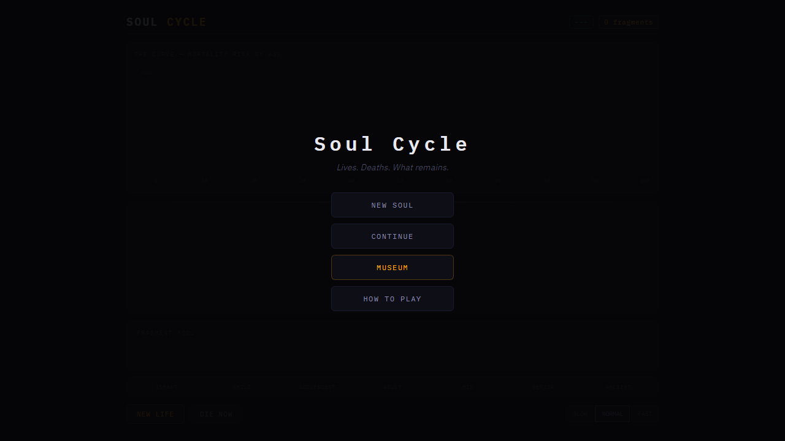
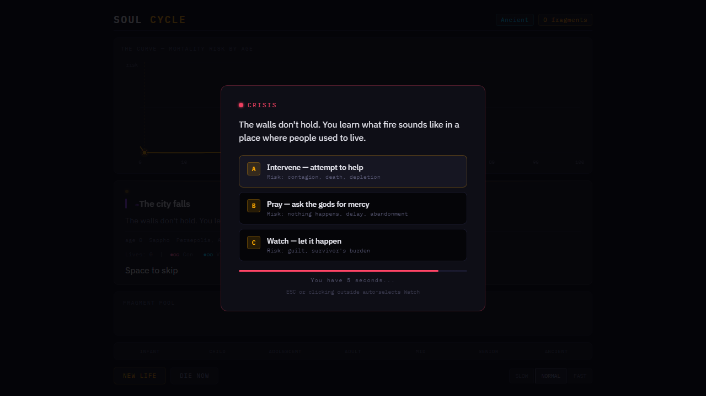
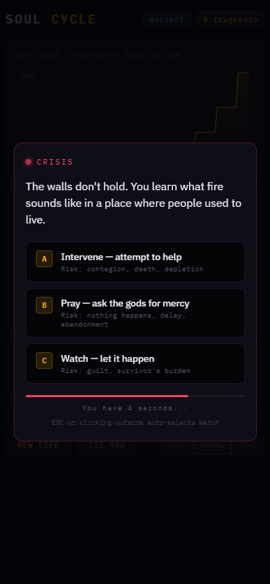

# Soul Cycle

A browser-based procedural life simulation where each lifetime is a run, death is part of the loop, and fragments of past lives bias what happens next.

**Live demo:** https://galtoast.github.io/soul-cycle/



## Why It Exists

Soul Cycle is a compact systems-design experiment: can a plain JavaScript browser game create the feeling of continuity across many short lives?

Each run gives the player a generated era, identity, location, mortality curve, event stream, crisis choices, and extracted memory fragments. Those fragments persist in `localStorage`, become anchors when they recur, and shape future lives.

## Screenshots

| Crisis system | Mobile layout |
|---|---|
|  |  |

## Core Systems

- **Life generation:** era, name, location, age, social context, resources, and starting circumstances.
- **J-curve mortality:** high risk in infancy and old age, lower risk through mid-life.
- **Crisis decisions:** timed A/B/C choices with different risk profiles.
- **Fragments and anchors:** memories extracted at death and carried into future lives.
- **Era progression:** new eras unlock as the soul accumulates fragments.
- **Museum mode:** persistent archive of lives, events, fragments, chains, achievements, and era statistics.
- **Responsive UI:** the demo is designed to run as a static GitHub Pages site.

## Technical Notes

- Vanilla JavaScript with ES modules; no build step required.
- `index.html` provides the shell and visual system.
- `js/game.js` holds core state, era data, generation helpers, and mortality data.
- `js/main.js` wires the loop, life arcs, controls, and UI state.
- `js/events.js` handles event selection, crisis resolution, and cascade tags.
- `js/ui.js` owns DOM rendering, canvas drawing, modal surfaces, and museum views.
- `js/save.js` persists soul state to `localStorage`.
- `js/audio.js` uses Web Audio synthesis plus the original AI-generated soundtrack in `assets/music/`.
- `music.html` is a local soundtrack browser for the included project music.
- `src/` contains earlier engine prototypes retained as design reference; the playable demo runs from `index.html` and `js/`.

## Running Locally

Because the game uses ES modules, serve the folder over HTTP:

```powershell
python -m http.server 5177 --bind 127.0.0.1
```

Then open:

```text
http://127.0.0.1:5177/
```

## Soundtrack

The MP3 files in `assets/music/` are original AI-generated music created by Fred McCullough for Soul Cycle. They are included as part of the game presentation, while source code remains under the MIT license. See `assets/README.md` for the asset rights note.

## Repository Hygiene

The public repo intentionally excludes internal playtest recruiting drafts until their wording is ready for publication.

## Status

This is an in-development portfolio demo. The current focus is the procedural loop, state persistence, crisis UI, and systems architecture rather than commercial launch packaging.
